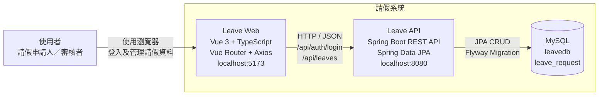

# 請假系統 C4 Container Diagram

本圖描述請假系統目前的執行期容器，以及使用者、前端、後端與資料庫之間的關係。

## 容器責任

| 容器      | 技術                                 | 責任                                                     |
| --------- | ------------------------------------ | -------------------------------------------------------- |
| Leave Web | Vue 3、TypeScript、Vue Router、Axios | 顯示登入與請假畫面、管理 loading／錯誤狀態、呼叫後端 API |
| Leave API | Spring Boot、Spring Data JPA         | 驗證登入、處理請假 CRUD、驗證狀態、統一 API 回應與例外   |
| MySQL     | MySQL、Flyway                        | 保存 `leave_request`，由版本化 Migration 管理 Schema     |

## 圖面邊界

- 正式執行時資料存放於 MySQL；自動測試改用 H2 的 MySQL 相容模式。
- 登入目前只是 `admin`／`1234` 的最小骨架，尚未建立 Session、Token、使用者資料表或角色授權。
- 前端不直接存取資料庫；所有資料操作都必須經過 Leave API。
